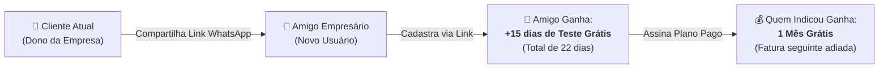
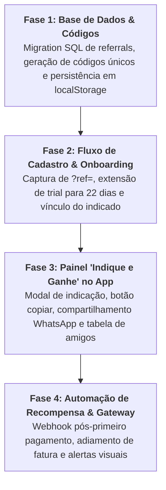

# 🎁 Programa "Indique e Ganhe" — Previna SaaS

Planejamento técnico, arquitetural e de produto para o programa de recomendação entre empresários (*Member-Get-Member*) do **Previna Gestão Financeira**.

---

## 1. 🎯 Proposta de Valor & Mecânica "Ganha-Ganha"

Para que o programa tenha tração orgânica real entre os empresários e lojistas que já utilizam o Previna, a mecânica deve ser simples, transparente e vantajosa para os dois lados:



### 🎁 Benefícios Definidos

| Participante | Benefício Concedido | Momento da Liberação |
| :--- | :--- | :--- |
| **Quem Indica** (*Referrer*) | **1 Mensalidade 100% Grátis** (acumulável) por indicação convertida | Quando o amigo indicado pagar a primeira fatura da assinatura |
| **Amigo Indicado** (*Referee*) | **+15 Dias Adicionais de Teste Grátis** (22 dias totais) para testar sem pressa | Imediatamente na criação da conta via link de indicação |

> [!TIP]
> **Acúmulo de Benefícios:** Se o lojista indicar 3 amigos e todos assinarem, ele ganha **3 meses consecutivos sem pagar assinatura** (economia direta de até R$ 209,70 no plano Avançado). Isso transforma seus clientes mais satisfeitos no principal canal de vendas do software.

---

## 2. 🏗️ Arquitetura de Dados no Supabase

### 2.1. Tabela `referrals` (Rastreamento de Indicações)

Armazena o vínculo entre a empresa indicadora e a empresa indicada, além do histórico do ciclo de vida:

```sql
CREATE TABLE IF NOT EXISTS public.referrals (
  id UUID PRIMARY KEY DEFAULT gen_random_uuid(),
  referrer_client_id UUID NOT NULL REFERENCES public.clients(id) ON DELETE CASCADE,
  referred_client_id UUID REFERENCES public.clients(id) ON DELETE SET NULL,
  referral_code TEXT NOT NULL,
  referred_email TEXT,
  status TEXT NOT NULL DEFAULT 'trialing' CHECK (status IN ('trialing', 'active', 'rewarded', 'churned')),
  reward_months_awarded INT DEFAULT 0,
  created_at TIMESTAMP WITH TIME ZONE DEFAULT timezone('utc'::text, now()) NOT NULL,
  converted_at TIMESTAMP WITH TIME ZONE,
  rewarded_at TIMESTAMP WITH TIME ZONE
);

CREATE INDEX idx_referrals_referrer ON public.referrals(referrer_client_id);
CREATE INDEX idx_referrals_code ON public.referrals(referral_code);
CREATE INDEX idx_referrals_referred ON public.referrals(referred_client_id);
```

### 2.2. Campo `referral_code` na tabela `clients`

Cada empresa possui um código amigável e único gerado automaticamente no cadastro (ex: `MERCADOPONTOCERTO`, `OFICINASILVA`, ou código aleatório legível de 6 dígitos):

```sql
ALTER TABLE public.clients 
ADD COLUMN IF NOT EXISTS referral_code TEXT UNIQUE,
ADD COLUMN IF NOT EXISTS referred_by_code TEXT;
```

---

## 3. 💳 Automação com o Gateway de Pagamentos (Pagar.me / Asaas)

Para conceder a mensalidade grátis sem necessidade de intervenção manual ou estorno bancário:

1. **Quando o Indicado Assina:** O webhook do gateway confirma o pagamento da primeira fatura (`subscription.paid` ou `invoice.paid`);
2. **Trigger de Recompensa:** O sistema localiza o registro em `referrals` com status `trialing` e avança para `converted`;
3. **Adiamento da Cobrança:**
   - Na assinatura da empresa indicadora (`subscriptions`), a data de vencimento da próxima fatura (`current_period_end`) é **postergada em +30 dias**;
   - Via API do Pagar.me/Asaas, o ciclo da assinatura é ajustado para a nova data futura (`postpone_next_charge` ou `next_billing_at += 30 days`), garantindo que o gateway não dispare cobrança no cartão naquele mês;
4. **Notificação de Sucesso:** Disparo de aviso no sininho do sistema e WhatsApp comemorando:
   > *"Parabéns! Seu amigo [Nome da Empresa] ativou a assinatura do Previna. Você acaba de ganhar 1 mês grátis na sua mensalidade!"*

---

## 4. 🎨 Ergonomia & Interface (UI/UX)

### 4.1. Link e Compartilhamento em 1 Clique
No menu do usuário e na tela de Configurações, surgirá o card e modal **"🎁 Indique e Ganhe Meses Grátis"**:
- **Link Pessoal:** `https://gestaoprevina.com.br/onboarding?ref=SEUCODIGO`
- **Botão "Copiar Link"**: Cópia instantânea para a área de transferência com feedback visual;
- **Botão "Enviar no WhatsApp"**: Abre diretamente o WhatsApp com mensagem pronta convincente:
  > *"Olá! Estou usando o Previna para organizar as finanças e o caixa da minha empresa e tem sido excelente. Consegui um link exclusivo para você testar com 22 dias grátis: https://gestaoprevina.com.br/onboarding?ref=SEUCODIGO"*

### 4.2. Dashboard de Acompanhamento das Indicações
Dentro da aba de indicações, o empresário tem total transparência:
- **Cards de Métricas:**
  - 👥 Amigos Convidados (Total)
  - ⏳ Em Período de Testes (Potenciais)
  - 🎉 Assinaturas Ativas (Convertidas)
  - 💵 Economia Total Gerada (R$ acumulados)
- **Tabela de Indicações:**
  - Nome da Empresa Amiga
  - Data do Cadastro
  - Status em tempo real (`Em Teste Grátis` / `Assinatura Ativa ✅` / `Mês Grátis Aplicado 🎁`)

### 4.3. Experiência do Amigo Indicado no Onboarding
Ao abrir o link `?ref=CODIGO`:
- O formulário de `Onboarding.tsx` exibe um banner de destaque no topo:
  > *✨ Indicação de [Nome da Empresa]: Você ganhou 22 dias de teste gratuito sem custo!*
- O campo do código é gravado silenciosamente no cookie/localStorage garantindo atribuição mesmo se o usuário fechar a aba e voltar depois.

---

## 5. 🗺️ Roteiro de Implementação Faseado



### Detalhamento das Fases:
- **Fase 1 (Banco & Tracking):**
  - Migration `create_referrals_and_codes.sql`;
  - Função utilitária de geração e validação de slug/código;
  - Captura do parâmetro `?ref=` na Landing Page e Onboarding com armazenamento resiliente em cache.
- **Fase 2 (Onboarding Especial):**
  - Identificação de convite no Onboarding e concessão de trial estendido de 22 dias;
  - Criação do registro de indicação com status `trialing`.
- **Fase 3 (Interface do Lojista):**
  - Componente oficial `ReferralProgramDialog.tsx` e card na aba de Configurações/Assinaturas;
  - Botão de envio rápido para WhatsApp (`wa.me/?text=...`).
- **Fase 4 (Liquidação de Benefícios):**
  - Rotina de verificação no webhook de faturas pagas;
  - Aplicação do mês grátis postergando a data da próxima cobrança no Pagar.me/Asaas e Supabase.
